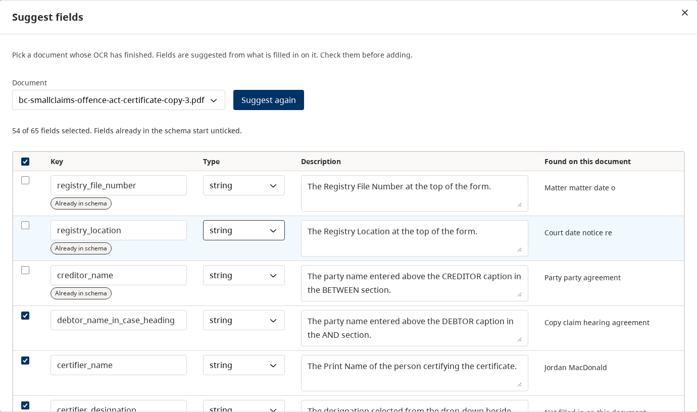
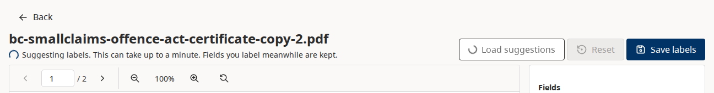
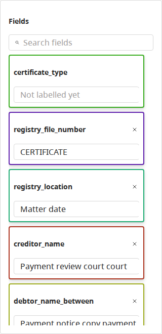

# Template Models

## Overview

Template Models enable organizations to train custom Azure Document Intelligence models for domain-specific field extraction. Instead of relying on generic prebuilt models (like `prebuilt-layout`), users create a Template Model, define its field schema, label example documents, and train the model. Once trained, the model appears in the processing model dropdown for document uploads.

The system follows a **model-first** architecture: the Template Model is the primary entity. Training is an operation on a model, not a way to produce a model from a project.

## Core Concepts

- **Template Model**: The primary entity. Has a display `name` and an auto-generated Azure-safe `model_id` (immutable after creation).
- **Field Schema**: User-defined fields the model should extract (e.g., `invoice_number`, `total_amount`, `date`).
- **Labeled Documents**: Example documents with manually annotated field values and bounding boxes.
- **Training Job**: An async process that uploads labeled data to Azure and trains the custom model.
- **Trained Model Version**: Metadata stored after each successful training. Versions accumulate per Template Model (v1, v2, ...); exactly one version is active at a time and is what document processing resolves to.

## Model ID Generation

When creating a Template Model, the user provides a free-text display name (e.g., "Invoice Extractor Q1"). The system auto-generates an Azure-safe `model_id`:

1. Lowercase the name
2. Replace spaces and non-alphanumeric chars with `-`
3. Keep only characters in `[a-z0-9._~-]`
4. Collapse consecutive `-` into one
5. Trim leading/trailing `-`
6. Truncate to 64 chars
7. Ensure starts with letter/number
8. On uniqueness collision, append `-2`, `-3`, etc.

The `model_id` is immutable after creation and is used as the Azure Document Intelligence model identifier.

## Status Lifecycle

```
draft → training → trained
                  ↘ failed
```

- **draft**: Model created, can define fields and label documents
- **training**: Training job in progress
- **trained**: Model successfully trained and available for document processing
- **failed**: Training failed (can retry)

## Database Schema

```
TemplateModel (template_models)
  ├── FieldDefinition[]    (field schema)
  ├── LabeledDocument[]    (training data)
  ├── TrainingJob[]        (training history)
  └── TrainedModel[]       (trained versions; exactly one active)

TrainingJob (training_jobs)
  └── TrainedModel?        (one-to-one)

TrainedModel (trained_models)
  └── model_id @unique     (v1 keeps the bare TemplateModel.model_id; v2+ append "-v<n>")
```

Key constraints:
- `TemplateModel.model_id` is globally unique
- `TrainedModel` is unique on `(template_model_id, version)`; versions are sequential per template (`max(version) + 1`, counting tombstoned rows)
- Exactly one `TrainedModel` per template has `is_active = true`; activation atomically demotes all sibling versions
- `TrainedModel.training_job_id` is unique (one-to-one with job)
- Retraining creates a new TrainedModel version and marks it active; previous versions are kept
- Deleting a version is a tombstone (`deleted_at` set, Azure artifact removed) so audit trails still resolve; the row is never physically deleted
- `ModelOwner` (`model_owners`) records the group of every model id a training targets. It is written in the transaction that creates the training job and is never deleted, so a deleted template's models, which can remain in Azure, stay its group's: other groups cannot run them and new templates cannot take their ids. Its migration filled it from the trained models, training jobs and training audit events that existed when it ran
- Deleting a template answers `409` while one of its trainings is in progress or a benchmark definition names one of its versions, as deleting a version does. Otherwise it deletes its rows (versions and training jobs cascade), then deletes its models from Azure, the active one included, best effort; a failed Azure delete is logged
- `FieldDefinition.description` (optional) is plain-English instructions used by label suggestions; it is not exported to training files

## Backend Architecture

### Module Structure

```
apps/backend-services/src/template-model/
  template-model.module.ts
  template-model.controller.ts        # api/template-models
  template-model.service.ts           # Business logic + model_id generation
  template-model-db.service.ts        # Prisma access for template models
  template-model-ocr.service.ts       # Azure OCR for uploaded documents
  labeling-document-db.service.ts     # Prisma access for labeling documents
  label-suggestions/
    tagged-text.ts                    # Stored OCR rendered as text with line, cell and checkbox tags
    resolve-refs.ts                   # LLM tag references back to OCR element ids
    suggestion-llm.ts                 # Azure OpenAI call with a strict reply schema
    prompts.ts                        # Suggested-field and suggested-label prompts and reply schemas
    label-suggestion.service.ts       # Suggested fields and suggested labels
  format-suggestion.service.ts        # AI format-spec suggestions
  dto/
    create-template-model.dto.ts      # Create/Update DTOs
    template-model-responses.dto.ts   # Response DTOs
    add-document.dto.ts
    export.dto.ts
    field-definition.dto.ts
    field-suggestion.dto.ts
    format-suggestion.dto.ts
    label.dto.ts
    labeling-conversion-failed-response.dto.ts
    labeling-upload.dto.ts
    suggestion.dto.ts

apps/backend-services/src/training/
  training.module.ts
  training.controller.ts              # Training endpoints under api/template-models
  training.service.ts                 # Training orchestration
  training-db.service.ts              # Prisma access incl. version activation/tombstoning
  training-poller.service.ts          # Polls Azure for training status
  dto/
    start-training.dto.ts             # Optional description, buildMode, maxTrainingHours (no modelId)
    training-info.dto.ts
    training-job.dto.ts
    trained-model.dto.ts
```

### API Endpoints

#### Template Model CRUD

| Method | Path | Description |
|--------|------|-------------|
| GET | `/api/template-models` | List all template models (filtered by group) |
| POST | `/api/template-models` | Create (name + description + group_id) |
| GET | `/api/template-models/:id` | Get details |
| PUT | `/api/template-models/:id` | Update (name, description, status) |
| DELETE | `/api/template-models/:id` | Delete |

#### Field Schema

| Method | Path | Description |
|--------|------|-------------|
| GET | `/api/template-models/:id/fields` | Get field schema |
| POST | `/api/template-models/:id/fields` | Add field |
| POST | `/api/template-models/:id/fields/bulk` | Add several fields in one transaction (409 lists keys that exist or repeat) |
| POST | `/api/template-models/:id/field-suggestions` | Suggest a field list from one document (body `{ document_id }`) |
| PUT | `/api/template-models/:id/fields/:fieldId` | Update field |
| DELETE | `/api/template-models/:id/fields/:fieldId` | Delete field |

#### Documents & Labels

| Method | Path | Description |
|--------|------|-------------|
| GET | `/api/template-models/:id/documents` | List documents |
| POST | `/api/template-models/:id/documents` | Add document |
| POST | `/api/template-models/:id/upload` | Upload and OCR |
| GET | `/api/template-models/:id/documents/:docId` | Get document |
| GET | `/api/template-models/:id/documents/:docId/view` | Stream normalized PDF for in-app display |
| GET | `/api/template-models/:id/documents/:docId/download` | Download original file |
| DELETE | `/api/template-models/:id/documents/:docId` | Remove document |
| GET | `/api/template-models/:id/documents/:docId/labels` | Get labels |
| POST | `/api/template-models/:id/documents/:docId/labels` | Save labels |
| DELETE | `/api/template-models/:id/documents/:docId/labels/:labelId` | Delete label |
| GET | `/api/template-models/:id/documents/:docId/ocr` | Get OCR data |
| POST | `/api/template-models/:id/documents/:docId/suggestions` | Suggested labels for a document (LLM) |
| POST | `/api/template-models/:id/export` | Export for training |
| POST | `/api/template-models/:id/suggest-formats` | AI-suggested format specs (accepts optional `benchmarkRunIds` body) |

#### Training

| Method | Path | Description |
|--------|------|-------------|
| GET | `/api/template-models/training/info` | Azure resource region + neural quota (FYI for the train UI) |
| GET | `/api/template-models/:modelId/training/validate` | Check training readiness |
| POST | `/api/template-models/:modelId/training/train` | Start training |
| GET | `/api/template-models/:modelId/training/jobs` | List training jobs |
| GET | `/api/template-models/training/jobs/:jobId` | Get job status |
| DELETE | `/api/template-models/training/jobs/:jobId` | Cancel job |
| GET | `/api/template-models/:modelId/training/versions` | List trained versions |
| GET | `/api/template-models/:modelId/training/versions/:versionId/snapshot` | Get dataset snapshot for a version |
| POST | `/api/template-models/:modelId/training/versions/:versionId/activate` | Set the active trained version |
| DELETE | `/api/template-models/:modelId/training/versions/:versionId` | Delete (tombstone) a trained version |

## Frontend Architecture

### Routes

| Route | Page | Description |
|-------|------|-------------|
| `/template-models` | ModelListPage | List and create template models |
| `/template-models/:modelId` | ModelDetailPage | Detail view with tabs |
| `/template-models/:modelId/document/:documentId` | LabelingWorkspacePage | Document labeling |

### File Structure

```
apps/frontend/src/features/annotation/template-models/
  types/training.types.ts
  hooks/
    useTemplateModels.ts     # CRUD for template models and documents
    useTraining.ts           # Training validation, jobs, start/cancel
    useTrainingInfo.ts       # Azure region + neural quota (training/info)
    useTrainedVersions.ts    # Trained versions list, activate, delete, snapshot
    useLabels.ts             # Label management
    useFieldSchema.ts        # Field schema CRUD
    useSuggestions.ts        # Suggested labels for the labelling screen
    useFieldSuggestions.ts   # Suggested fields from a document
  pages/
    ModelListPage.tsx        # Grid of ModelCards with create modal
    ModelDetailPage.tsx      # Tabbed detail view (Documents, Field Schema, Export, Training, Versions)
    LabelingWorkspacePage.tsx
  components/
    ModelCard.tsx            # Card with name, model_id, status badge
    TrainingPanel.tsx        # Train button + job status (no model_id input)
    TrainedVersionsPanel.tsx # Version list with activate/delete actions
    TrainedVersionSnapshotDrawer.tsx
    LabelingToolbar.tsx
    ExportPanel.tsx
    FieldSchemaEditor.tsx
    SuggestFieldsModal.tsx   # Suggest fields: pick a document, review, add
```

### Labeling workspace layout

The labeling route uses a **full-viewport workspace** with the BC footer below it (page scroll to reach the footer). The document canvas and field panel fill one viewport height; the field list scrolls independently in a fixed-width right panel (`FieldListScrollArea`). The canvas top-aligns the page image and uses full fit scale.

### Key UX Changes

- **Create modal**: User enters a display name; model_id preview shown below the input
- **Training panel**: No model_id input — just click "Train" with optional description
- **Model card**: Shows both friendly name and copyable `model_id`
- **Status badges**: draft (blue), training (yellow), trained (green), failed (red)
- **Build mode**: TrainingPanel exposes a Template/Neural segmented selector. When Neural is selected, an FYI banner shows region + neural quota and the `Max training hours` input appears (default 1h). The backend caps `maxTrainingHours` at 10 — Azure's free-tier ceiling. Anything above 10 hours requires a configured Azure budget; the API rejects such requests as a guardrail against unintended spend.
- **Suggest Formats**: On the Field Schema tab, clicking "Suggest Formats" calls the AI endpoint with HITL corrections. Accepts an optional `suggestFromRun` query param to also include benchmark run mismatch data — when present, the suggestion runs automatically on page load.

### Format Suggestions with Benchmark Data

The `POST /api/template-models/:id/suggest-formats` endpoint accepts an optional `benchmarkRunIds` array in the request body. When provided, mismatch pairs from those runs (where `matched === false` in `evaluationDetails`) are merged with HITL corrections before being sent to the AI. The prompt will say "corrections and benchmark mismatches" instead of "HITL corrections".

From the RunDetailPage, the "Suggest Formats" button opens a modal to select a template model, then navigates to `/template-models/:tmId?suggestFromRun=<runId>`. On ModelDetailPage, if the `suggestFromRun` query param is present, the format suggestion call is automatically triggered on mount with that run ID included.

## Label Suggestions

Suggested fields and suggested labels come from an LLM reading a document's stored layout OCR. Nothing is stored: every request is a fresh call, and nothing becomes a label until the user saves.

1. **Tagged text.** `tagged-text.ts` copies `analyzeResult.content` in reading order and inserts `[L12]` at each line, `[T2 r3 c1]` at each table cell, and `[S4 ☒]` / `[S4 ☐]` in place of each checkbox. A line whose words all sit in table cells gets no tag of its own.
2. **LLM call.** `suggestion-llm.ts` calls the deployment named by `AZURE_OPENAI_ENDPOINT`, `AZURE_OPENAI_API_KEY`, `AZURE_OPENAI_DEPLOYMENT` and `AZURE_OPENAI_API_VERSION`, the same settings as the workflow agent — including the API version each environment sets, which [AGENT_SETUP.md](../workflows/AGENT_SETUP.md) lists. It uses the Vercel AI SDK's structured output. The reply names tags plus the value's exact text, never positions.
3. **Resolution.** `resolve-refs.ts` finds that text among the tag's words and returns the element ids the labelling screen uses (`p{page}-w{index}`, `p{page}-sm{index}`). Anything that does not match is dropped, not guessed. Words already used by an earlier field are skipped.

**Suggest fields** (Field schema tab → Suggest fields) proposes keys, types, one-line descriptions and the value found on the chosen document, as a table with one row per field. Keys already in the schema start unticked and are marked "Already in schema"; renaming a key into one that exists, or using one twice, blocks adding until it is fixed. The user edits the list and adds it through the bulk endpoint. The labelling screen then drafts that document's labels like any other.



**On the labelling screen,** opening a document with no saved labels requests suggestions automatically, and **Load suggestions** requests them again. Either way the suggestions only fill fields the user has not labelled: a field that already has words keeps them, and a word already assigned to a field is never moved (`utils/mergeSuggestedAssignments.ts`). The header shows that suggestions are running while the call is in flight. A field's value lists its words in OCR reading order.





**Latency:** one call reads the whole document, so it takes seconds to tens of seconds, depending on the model and the document; a 2-page form took 20–45 s on gpt-5.6-sol and 8 s on gpt-4o. The backend gives the call up to 120 s (`LLM_TIMEOUT_MS`), so on OpenShift the frontend and backend Routes and the frontend's nginx wait 150 s (see [KUSTOMIZE_INSTANCE_TEMPLATE.md](../operations/KUSTOMIZE_INSTANCE_TEMPLATE.md#route-timeouts)).

**Limits and errors:**

| Status | When |
|---|---|
| 422 | over 30 pages or 120,000 tagged characters, or no fields for label suggestions |
| 502 | the model call failed; the body carries a `reason` |
| 503 | settings missing; the body lists the missing setting names |

**Data handling:** suggestions send the document's OCR text to the configured Azure OpenAI deployment. Point the settings only at a deployment approved for the documents' classification.

## Training Flow

1. User creates a Template Model (name auto-generates model_id)
2. Defines field schema (field keys + types)
3. Uploads documents (OCR processed automatically)
4. Labels documents with field values and bounding boxes
5. Clicks "Train" on the Training tab
6. Backend validates readiness (minimum labeled docs — `TRAINING_MIN_DOCUMENTS` env var, default 5 — schema defined, all docs have labels)
7. Uploads training data to Azure Blob Storage
8. Submits to Azure Document Intelligence with `buildMode` matching the user's selection (`template` or `neural`); for neural, also passes `maxTrainingHours` if provided.
9. Poller checks Azure every 10 seconds and continues until Azure reports a terminal status (`succeeded`, `failed`, or `canceled`). Neural builds can legitimately run for hours past the requested `maxTrainingHours` while Azure finalizes, so the poller defers to Azure's authoritative status. A local wall-clock safety net (`TRAINING_MAX_WALL_CLOCK_HOURS`, default 24h) marks the job FAILED if Azure never returns a terminal status — Azure may still be running, so the failure message directs the user to the Azure portal.
10. On success: TrainedModel record created with `build_mode`, `max_training_hours`, and `actual_training_hours` (the read-only `trainingHours` Azure returned). Model appears in upload dropdown.

## Model Availability

Trained models appear in the "Processing Model" dropdown on the upload page and in the review queue's model filter. The `/api/models` endpoint merges:
- Prebuilt models from `AZURE_DOC_INTELLIGENCE_MODELS` env var
- The `TrainedModel.model_id` values, without tombstoned versions, of the template models of the group in `group_id` (the caller must belong to it), or of every group the caller belongs to when `group_id` is omitted. The frontend passes the active group.
