# Workflow builder — the gallery

**A guided tour of the workflow builder, in 16 stops.** Each stop opens something
already built for you, tells you what to click, and shows you what you should be
looking at. About **45 minutes** end to end. Stops 1–8 are the core; if you only
have twenty minutes, stop there.

Somebody has to bring the local stack up and seed it first, though — that's the
**Before you start** section below, about ten minutes of terminal, once. After
that the tour is clicking and reading. If a button doesn't do what this page says
it will, that's a finding — write it down and keep going.

> **This is not the test plan.** [MANUAL_TEST_PLAN.md](./MANUAL_TEST_PLAN.md) is
> the exhaustive checklist: 150-odd checks including the awkward ones that need
> SQL, `curl` and environment flags. It exists to prove coverage. *This* page
> exists to show you the product. Each stop lists the plan IDs it covers, so
> finishing the gallery tells you what the plan can consider walked.

**A word on the words.** A *workflow* is a diagram of work to be done. Each box in
it is a *step*. Steps are joined by *wires*. Running a workflow once is a *run*.
That's the whole vocabulary — with one caution, because two of those words look
alike. The numbered sections of *this page* are **stops** on a tour. A **step** is
always a box inside a workflow. So "skip to stop 11" means a section of this
document, never a node on the canvas.

## Before you start

### 1 · Bring the stack up

If this is your first time in the repo, work through the [Quick Start in the root
`README.md`](../../README.md#quick-start) first — Node version, the root `.env`,
migrations, and `npm run db:seed`. There is one `.env`, at the repo root: the
backend, the frontend, the Temporal worker, the database seed and the demo
seeders below all read it, and no app has its own. Come back here once
`http://localhost:3000` loads and you can sign in. That seed is also where
**Standard OCR Workflow** (stops 1 and 8) comes from: it is loaded from
[`templates/standard-ocr-workflow.json`](./templates/standard-ocr-workflow.json)
by `apps/shared/prisma/seed.ts`.

Seven processes have to be live: postgres, minio and the Temporal server; the
deno-runner; and the backend, the frontend and the Temporal worker. The VS Code
task **Dev: all** starts all of them (it runs on folder open — see
`.vscode/tasks.json`). The command-line equivalent, from the repo root:

```bash
docker compose --profile infra --profile temporal up -d            # postgres, minio, temporal
docker compose -f deployments/local/docker-compose.deno.yml up -d  # deno-runner, host port 9099
npm run dev                                                        # backend :3002, frontend :3000, Temporal worker
```

The **deno-runner** is the one that's easy to miss: nothing outside stops 14 and
15 touches it. Without it, publishing a custom step fails with *"The custom-node
checker is not running, so this script could not be type-checked."* Confirm it
with `curl http://localhost:9099/health`.

**Regenerate the Prisma client** after you pull, switch branches, or move the
schema:

```bash
cd apps/backend-services && npm run db:generate
```

That script writes the generated client into two places —
`apps/backend-services/src/generated` and `apps/temporal/src/generated` — and
**both are gitignored**, which is what makes a stale one so baffling: `git
status` is clean, the branch is right, and nothing looks wrong. What goes wrong
instead is unrelated-looking. A run dies at its first step with `Cannot read
properties of undefined (reading 'findUnique')` — a model the running code
expects isn't on the generated client, so the property is simply `undefined`.
And the dynamic-nodes endpoint 500s, which the palette renders as a calm
**"No custom nodes yet"** under CUSTOM: identical to what it would say if you
genuinely had none. If either of those greets you, regenerate before debugging
anything else.

**No Azure account?** Put `MOCK_AZURE_OCR=true` in the root `.env` and restart
the Temporal worker. `submitToAzureOCR` then returns a mock request id
and `pollOCRResults` a canned succeeded response, so **Standard OCR Workflow**
runs end to end and stops 8–10 work without a credential. (The demo those stops
send you to needs no Azure either way — this is for walking the real OCR chain.)

### 2 · Seed the demo workflows

Most stops open a workflow whose name begins **🎯 Demo —**. Those don't exist
until you seed them. The seeder builds them through the running backend's API,
so the backend must be up and the database already seeded — otherwise every call
comes back 401. It also writes the assistant demo's chat log (stop 16) straight
into the database, using `DATABASE_URL` from the root `.env`.

```bash
npm run seed:demos       # the 🎯 Demo — … workflows
npm run seed:demo-runs   # optional: real runs to replay on stops 8, 9 and 10
```

**Start the deno-runner before you seed.** The two custom-step demos are
*published* through it, so seeding without it prints
`⚠ dynamic-node demo skipped` and
`– deleted-dyn    skipped (deno-runner unavailable)`, and stops 14 and 15 then
have nothing to open.

`npm run seed:demos` is idempotent — every run deletes the demos it made last
time and recreates them — so you can edit them freely and re-seed to restore.
Doing that orphans any seeded runs, so follow it with `npm run seed:demo-runs`
if you want those back. You don't need an API key of your own: the seeder reads
the root `.env`, the file `npm run db:seed` took the database's key from, and
tries each key the database could have been seeded with until one
authenticates. If none does, the database was seeded with a different key or
not at all: run `npm run db:seed` from `apps/backend-services`, which sets the
key to the root `.env`'s `TEST_API_KEY` (or the built-in default when that is
unset). Env vars, the full seeded list
and how to extend it are in
[FEATURE_DEMO_SEEDER.md](./FEATURE_DEMO_SEEDER.md).

### 3 · Reading the demo names

Every seeded name ends in something like **(Part 7)** or **(Part 14)**. Those are
Parts of [MANUAL_TEST_PLAN.md](./MANUAL_TEST_PLAN.md), **not** stops of this
tour: the demos were built for the test plan, and this page borrows them, so the
numbers deliberately don't line up. This page also shortens the names — where it
says **🎯 Demo — Typed I/O**, the workflow list shows *🎯 Demo — Typed I/O —
coloured handles & type pills (Part 7)*.

### 4 · What each stop needs

| Stops | What has to be running |
|---|---|
| 1–7, 11, 12, 13 | backend, frontend, database. (Actually *firing* a run from stop 12 or 13 also needs the Temporal worker; reading those panels doesn't.) |
| 8, 9, 10 | the **Temporal worker**, plus `npm run seed:demo-runs` for runs of each outcome to look at: a success, a cache hit and a failure |
| 14, 15 | the **deno-runner**, both when you seed and while you use them |
| 16 | credentials for the workflow agent — see [MANUAL_TEST_PLAN.md Part 1.4](./MANUAL_TEST_PLAN.md#part-1--environment--prerequisites) |

Now open the app and sign in. Everything happens under **Workflows** in the left
nav unless a stop says otherwise.

---

# Part one — look around

## 1 · A workflow, end to end
**⏱ 3 min** · Open **Standard OCR Workflow**

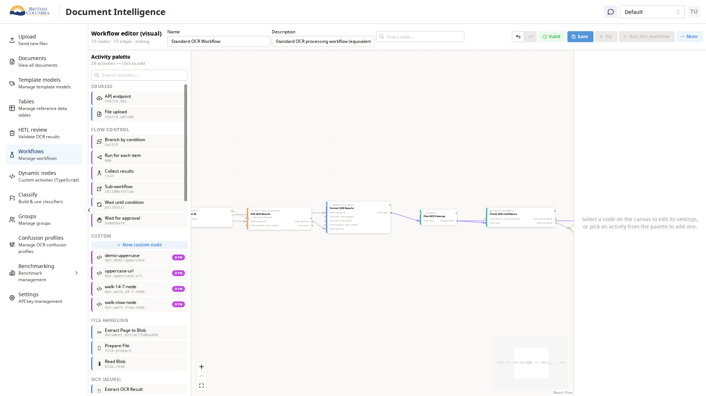

This is a real, working workflow: it takes a scanned document, sends it to Azure
for text recognition, waits for the answer, checks how confident the result is,
and either files it or sends it for human review.

**Look for**

- Steps read left to right. Each is a card with a title and a list of what it
  needs (left) and what it makes (right).
- The **ENTRY** tag marks where a run begins.
- The top bar tells you the size — *"11 nodes · 11 edges"* — and whether the
  workflow is **Valid**.

**Try this.** Drag on the empty canvas to pan; scroll to zoom. The **⛶** button at
the bottom-left fits the whole workflow on screen. In a narrow window it can't
zoom out quite far enough for a workflow this long; see the known gaps at the
end.

*Covers 3.1, 3.2, 16.1*

---

## 2 · Reading a step
**⏱ 3 min** · Open **🎯 Demo — Node settings panel & canvas basics**

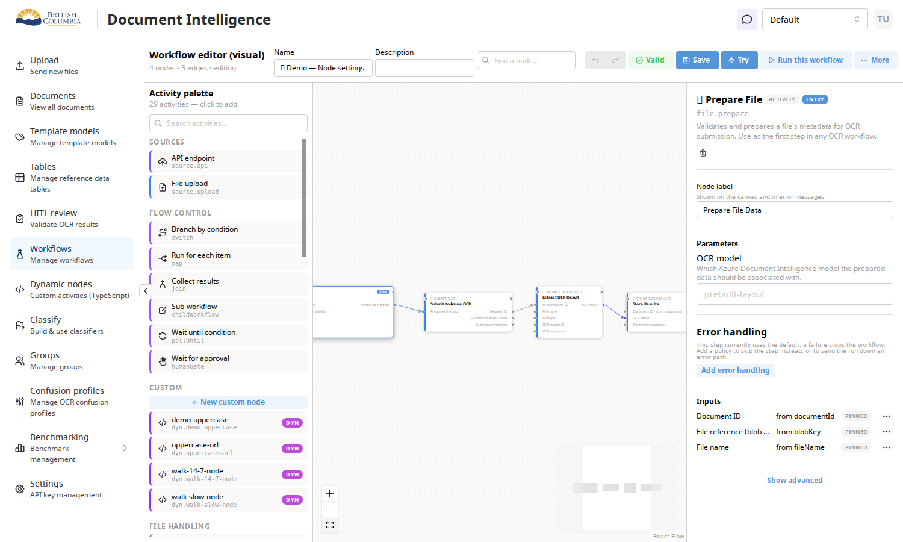

Click any step. A panel opens on the right — this is where a step is configured.

**Look for**

- **Node label** — what this step is called on the diagram. Yours to change.
- **Parameters** — the step's own settings. Any that must be filled in are
  marked with a `*`.
- **Inputs** — where each piece of information comes from, one row each. The tag
  on the right tells you who decided: **AUTO** (the builder worked it out),
  **PINNED** (someone chose it deliberately), or **Needs a source** (nothing feeds
  it yet).
- **Error handling** — what happens if this step fails. The default is *stop the
  workflow*.
- **Show advanced** at the bottom opens the raw wiring, if you want to see it.

**Something's off if** the panel is empty for a step that clearly has settings, or
if a required field shows no `*`.

*Covers 3.3, 3.4, 3.5, 3.6*

---

# Part two — build one

## 3 · Drop a step on the canvas
**⏱ 3 min** · **Workflows ▸ Create workflow**

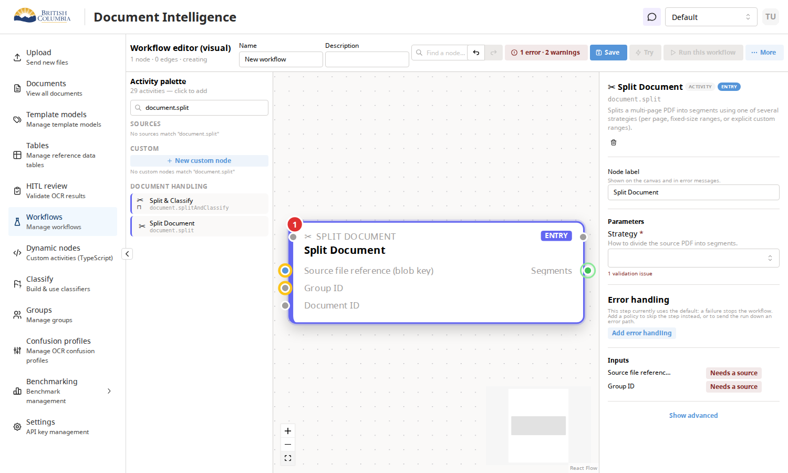

The left-hand **Activity palette** is the menu of everything a workflow can do,
grouped by what it's for — sources, flow control, custom code, document handling,
OCR.

**Do this**

1. Type `split` in the palette's search box.
2. Click **Split Document**. It lands on the canvas, already selected.

**Look for**

- The step arrives with its inputs and outputs already listed. You don't
  configure that — it comes with the step.
- Two of its inputs wear an **amber ring**, and the settings panel says
  **Needs a source** against each. Nothing feeds them yet.
- The top bar already reads **1 error · 2 warnings**. The builder started checking
  the moment the step existed; you don't have to ask.
- Because it's the first step, it's automatically the **ENTRY** point.

*Covers 3.1, 13.1, 8.14*

---

## 4 · Wiring: what fits what
**⏱ 4 min** · Open **🎯 Demo — Typed I/O**

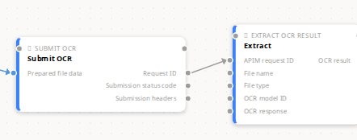

Every step says what it needs and what it makes, and the builder knows which
things fit together. Zoom in until you can read the labels.

**Look for**

- Coloured dots down each step's edges, one per input and output, each labelled —
  *Prepared file data*, *Request ID*, *Submission status code*.
- Every port carries a **kind** — the builder's word for the sort of thing that
  travels the wire, and the word the app itself uses (the field is labelled
  *Kind* wherever you can set one). `PreparedFile`, `DocumentRef`, `Segment`,
  `OcrResult` are kinds; you don't invent them, the step declares them.
- A dot's **colour and shape are the kind's family**, five in all: documents and
  files are blue circles, content taken out of a document is violet squares,
  labels and check results are yellow diamonds, IDs that point at something
  stored elsewhere are teal bars, and a port that takes anything is a hollow grey
  circle. The **Legend** button
  at the bottom of the canvas spells all five out.
- Hover a label and the tooltip gives the port's raw name, its kind, and a
  sentence — *"preparedData: PreparedFile — Object describing the validated file,
  ready for OCR submission."*

**Try this.** Everything in this demo is already wired, so nothing is amber here —
add a step from the palette and its unfed inputs will ring, exactly as at stop 3.
Now drag from an output dot on an existing step to one of those input dots. If the
two kinds fit, a wire appears and the ring clears. If they don't, no wire is
created and a note explains why — *"This input needs DocumentRef —
DocumentContent can't be used here."*

**Something's off if** a wire is created between two things the note says are
incompatible, or if an amber ring stays after you've connected something.

*Covers 7.1, 7.2, 7.3, 8.9, 8.10*

---

## 5 · When something's wrong
**⏱ 3 min** · Open **🎯 Demo — Validation surfacing**

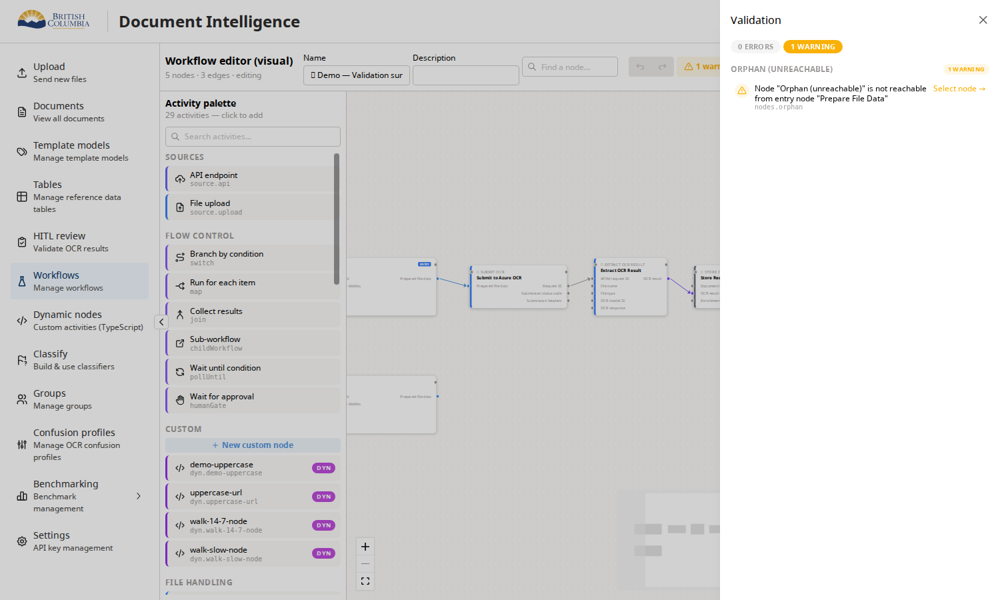

The builder checks your workflow continuously and tells you before you run it.

**Do this.** Click the **errors · warnings** chip in the top bar.

**Look for**

- The drawer separates **errors** (this can't run) from **warnings** (this can run,
  but look at it).
- Each entry names the step and says what's wrong in a sentence — here, a step
  that nothing leads to.
- **Select node →** jumps you to it.

**Worth knowing.** Warnings never block you. Errors don't block *saving* either —
you can save a half-built workflow and come back. They do block *running* it, and
the Run button will tell you so.

*Covers 5.4, 3.9, 3.10*

---

# Part three — branch and loop

## 6 · Choosing a path
**⏱ 4 min** · Open **🎯 Demo — Switch/error edges**

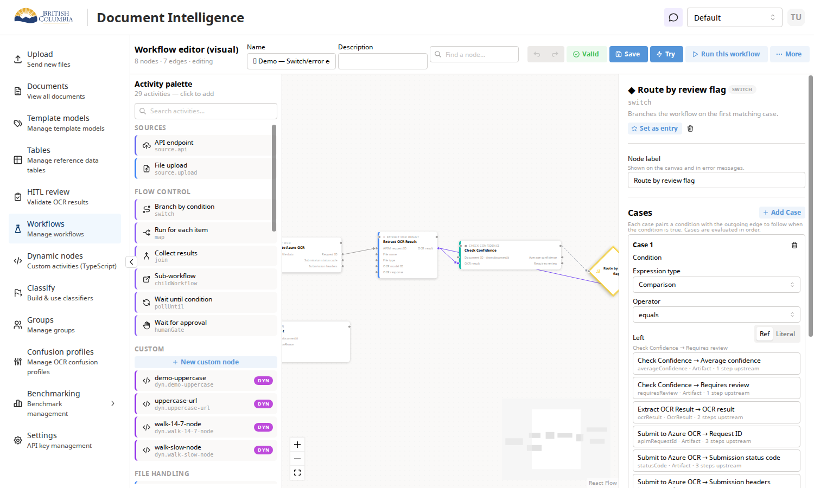

A **Branch by condition** step sends the run down one path or another. Click the
diamond-shaped step to open its cases.

**Look for**

- **Cases are evaluated in order** — the first one that matches wins. Each case
  pairs a condition with the wire to follow when it's true.
- A condition has an **Expression type** (compare two things, or combine several
  with and/or). A comparison reads in order: **Value to check**, **How to
  compare**, **Compare with**.
- Above the fields, the case writes its whole condition out as a sentence — *This
  case matches when Check Confidence → Requires review is equal to true.* — and
  keeps it in step as you edit.
- Each value is either a **Typed value** — a fixed number or piece of text you
  type — or **From a step**, pointing at something an earlier step produced.
- **From a step** gives you a list of earlier steps, not a box to type a variable
  name: *"Check Confidence → Requires review"*, with what kind of value it is and
  how many steps back it came from.

**Try this.** Toggle a value between **From a step** and **Typed value** and watch
the field change shape. Then look at the canvas: the branch has one outgoing wire
per case, so you can see the shape of the decision on the diagram, not just in
the panel.

*Covers 4.1–4.7, 5.1, 5.2, 5.3*

---

## 7 · Doing it for every page
**⏱ 4 min** · Build this yourself — **Workflows ▸ Create workflow**

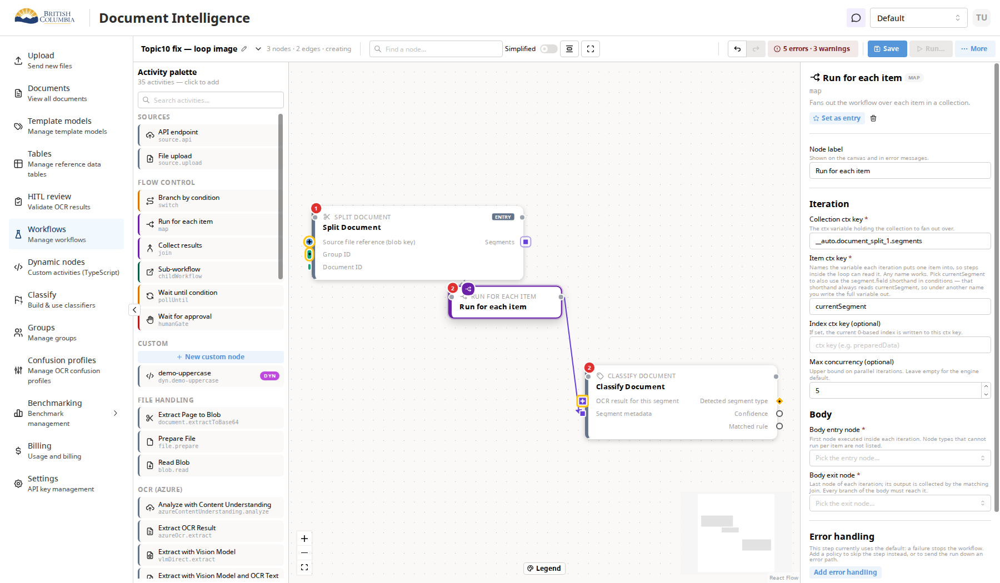

Some work has to happen once per page, per segment, per row. **Run for each item**
is the loop.

**Do this**

1. Add **Split Document**, then **Run for each item**, then **Classify Document**.
2. Wire the first to the second, and the second to the third.
3. Click the loop step. Under **Iteration**, **Item ctx key** already reads
   `currentSegment`: a new loop arrives with it filled in, and declares it as a
   workflow variable as it lands, so there is nothing to create. Leave it.

**Look for**

- **Collection ctx key** filled itself in — the builder found the nearest thing
  that produces a list and used it.
- **Item ctx key** came pre-filled, and `currentSegment` is not an arbitrary
  choice: the `segment.field` shorthand you can use in a branch condition always
  reads `currentSegment`, whatever you called the item. Rename the item and the
  shorthand quietly stops finding anything, so you'd write the variable out in
  full instead. Rename it when a second loop needs its own item — see below.
- Add a **second** loop and it also starts at `currentSegment`, which the
  validation panel flags as an amber **warning**, not an error: two loops writing
  one variable means a step that reads it can pick up the wrong loop's item, and
  a loop nested inside another would overwrite the outer item entirely. It never
  blocks **Save** — give one of the two loops its own item name if the warning
  applies to you.
- A **violet wire** now runs from the loop to the third step: that's the current
  item being handed to the body of the loop. Hover it and it says it was
  connected automatically.
- Violet because of what travels it, not because it's a loop. **Split Document**
  emits `DocumentSegment[]`, so one item off that list is a `DocumentSegment` —
  the violet *content taken out of a document* family from stop 4. Wire a loop
  over a different kind and you get that kind's colour.
- The **Run for each item** card is *also* purple, and that is a different purple
  for a different reason: a card's accent says what sort of step it is (the
  Legend calls this one *Repeats over a list, or gathers results*), while a
  wire's colour says what kind of data is on it.
  Two vocabularies, one hue family — worth knowing before you read anything into
  the match.
- Give the loop a moment; the wire appears once the loop knows both what it is
  looping over and what to call each item.
- The top bar counts **5 errors · 3 warnings**, and the cards carry red counts.
  That is the sketch being unfinished, not the loop going wrong: Split Document
  and Classify Document have settings you haven't chosen, three inputs have no
  source yet, and the loop doesn't yet name the steps it runs (**Body entry
  node** and **Body exit node**). None of them is about the item variable.

**Something's off if** no wire appears once **Collection ctx key** has resolved —
the item already has a name, so that half is not what's missing.

*Covers 8.7, part of 8.15*

---

# Part four — run it

## 8 · Try it, and watch ☁️
**⏱ 5 min** · Open **🎯 Demo — Try-in-place**, then **Standard OCR Workflow**

> **This stop needs the Temporal worker running.** `npm run seed:demo-runs` from
> [Before you start](#2--seed-the-demo-workflows) adds finished runs to look at.
> If **Run…** is greyed out, hover it: the tooltip *is* the reason, and it's one
> of *"Save the workflow first"*, *"Fix N validation errors first — this graph
> cannot run as it stands"*, or *"Save your changes first — a run always executes
> the saved graph, not the canvas"*. If nothing ever moves off *"Not run yet"*,
> the worker isn't up: skip to stop 11 and come back later.

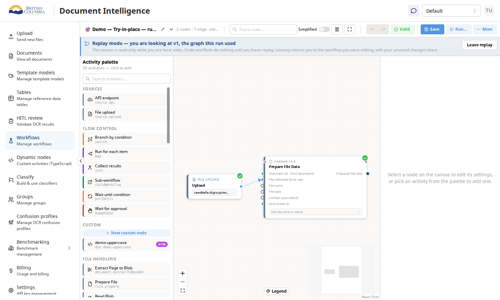

**Do this — start a run.** Open **🎯 Demo — Try-in-place — run a workflow & see
previews (Part 9)** and click **Run…** in the top bar. A drawer titled **Run this
workflow** opens on **Upload a file**: a file is this workflow's only way in, so
the drawer goes straight to it (stop 13 says more about that). Drop a PDF on the
box, or click the box to pick one — any small PDF will do, such as
`tests/e2e/workflow-builder/fixtures/documents/sample-invoice.pdf` from this
repo — and press **Run**. The drawer closes, a *Workflow run started* notice
appears, and within a few seconds both steps are green. This demo's steps run
against local Postgres and local blob storage only: no Azure, no credentials.

**Do this — watch one.** On the same demo, click **More ▸ Run history**. The
newest run is at the top, and each row starts with a status dot: green for a run
that succeeded, red for one that failed. Your run is there, and if you ran
`npm run seed:demo-runs`, three more sit below it: one green, one that came back
from cache, and one that genuinely failed. Press **Replay** on a row with a green
dot. To list only those, set **Status** at the top of the drawer to
**Succeeded**.

**Look for**

- A banner across the top of the canvas says **Replay mode — you are looking at
  v1, the graph this run used**, that the canvas is read-only, and offers
  **Leave replay**. You're looking at history, not the live diagram.
- Each step that ran shows its result on a slim one-line band under the step's
  name: the first line of the value it produced. Here the **Upload** step's band
  shows the key the file was stored under. **Prepare File Data**'s reads *"Not
  bound to a value"*: the step ran, but this demo doesn't write its output into a
  workflow variable, so the band has nothing to show. The band is there before
  you run anything, saying *"Not run yet"*, so the cards never move. On a live
  run, each card's status badge turns blue while its step runs and green when it
  finishes.
- The wire the run travelled is redrawn in pale blue. A branch the run didn't
  take keeps its resting colour, so on a workflow that branches you can see the
  path it chose; this demo has no branch.

**Where the Initial ctx box comes in.** Now open **Standard OCR Workflow** and
click **Run…**. This workflow takes more than a file, so the drawer has two tabs:

- **Try on canvas** — the run's results land on the diagram in front of you.
- **Call from outside** — the trigger URL, input schema and `curl` another system
  would use. That's stop 12.

On **Try on canvas**, the **Initial ctx** box holds the starting values a run
begins with. It's prefilled from the inputs the workflow *declares*: the fields of
an **API endpoint** step, or a variable ticked **Input** in Workflow settings.
Standard OCR Workflow declares one, `modelId` (the Azure model its OCR steps
use), with a default, so the box opens as:

```json
{
  "modelId": "sdpr_synth_test"
}
```

**Try** starts a run with whatever the box holds. The server checks it against
the declared inputs first — every required field present, every declared field
of its declared type — and refuses the run if not; keys the workflow doesn't
declare pass through. This workflow's first step, **Prepare File Data**, also
needs a `documentId` and a `blobKey`, naming a document that already exists in
the database and in blob storage, and fails without them:

```json
{
  "documentId": "<id of a document already in the system>",
  "blobKey": "<that document's stored file key>"
}
```

So nobody types this workflow's input by hand. Standard OCR Workflow's runs start
from the **Upload** page in the left nav: choose a **Processing model**, pick
**Standard OCR Workflow** under **Workflow (optional)**, add a file and press
**Upload**. The page stores the document and starts the run with both values
filled in. Its OCR steps call Azure, or the mock described under
[Before you start](#1--bring-the-stack-up). Run history lists only the runs
started in the editor to try a workflow out, so that run isn't there: an
uploaded document's progress is on the **Documents** page.

For the opposite case, open **🎯 Demo — Workflow-as-API** and press **Run…** there
— that workflow declares two fields, so the box arrives already written:

```json
{
  "documentUrl": "",
  "priority": 0
}
```

**Try this.** Edit a workflow and don't save it, then look at **Run…** — it goes
grey, and hovering it says why: *"Save your changes first — a run always executes
the saved graph, not the canvas"*. That's deliberate — a run should never execute
a diagram you aren't looking at.

*Covers 9.3, 9.4, 9.4a, 9.7, 9.9, 9.12*

---

## 9 · Reading the results ☁️
**⏱ 4 min** · Whichever workflow you replayed at stop 8, still in replay

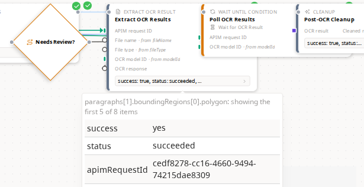

Each step keeps what it produced. The card shows you a one-line taste of it;
**click that line** and the full, scrollable result opens just below it.

**Look for**

- A table of the actual values — for the OCR step that's `success`, `status`, the
  request id, the recognised text. **Not** a storage path: the point is to see
  what came out, not where it was filed. The one-line version on the card follows
  the same rule: it summarises the text, not the file it was stored in.
- When a result is too big to show whole, a dimmed line says exactly what was
  trimmed — *"showing the first 5 of 8 items"*, *"showing 40 of 74 fields"*. It
  never quietly shortens something.
- A step with more than one output gets a row of small chips above the opened
  result, one per output; click between them, and the line on the card follows
  your choice.
- A step that produces nothing to look at — a branch, a loop, a wait — shows
  nothing at all, not even the line, and that's correct.

**Something's off if** a step shows a blank card with no explanation. Every state
has words, such as *Waiting*, *Running…*, *Not reached*, *Failed* and *Not
cached*. A blank card is a bug. So is a card that changes size when you press
run — the line is a fixed height precisely so the diagram holds still.

*Covers 9.5, 9.5a, 9.5b, 9.5c*

---

## 10 · What ran, and when ☁️
**⏱ 3 min** · **More ▸ Run history**

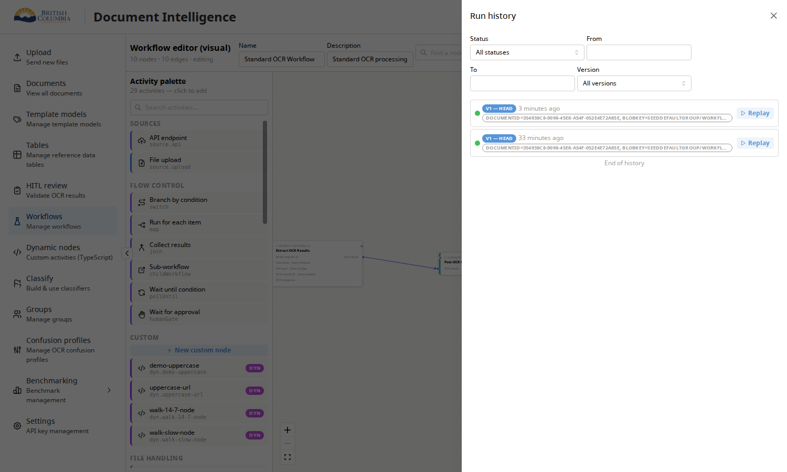

**Look for**

- One row per run: status dot, which version ran, how long ago, and a summary of
  what it was given.
- Only tries are listed: runs started from the Run drawer's **Try on canvas** tab
  or its **Upload a file** box. A document uploaded for processing is followed on
  the **Documents** page instead.
- Filters across the top — by status, by date, by version.
- **Replay** on any row puts that run back on the canvas.

**Try this.** Replay an old run, then click the result line on a step whose stored
result has since been cleaned up. The line reads *"Preview expired"*. Behind it is
a grey note — on a run of v1, *"This step completed. Preview unavailable — its
output isn't in the preview cache. Re-run v1 (the version you are viewing) to see
it."* — and a **Re-run v1** button, under the line *"Runs the whole workflow again
from the start, with the same input."* Results are kept for 14 days. You will
only ever see this on a run that has finished; on a live run a step that has
just gone green says *"Output pending"* instead, because nothing has expired —
the result is simply still on its way.

*Covers 9.8, 9.9, 9.10, 9.10a*

---

# Part five — ship it

## 11 · Versions
**⏱ 3 min** · Open **🎯 Demo — Versioning**

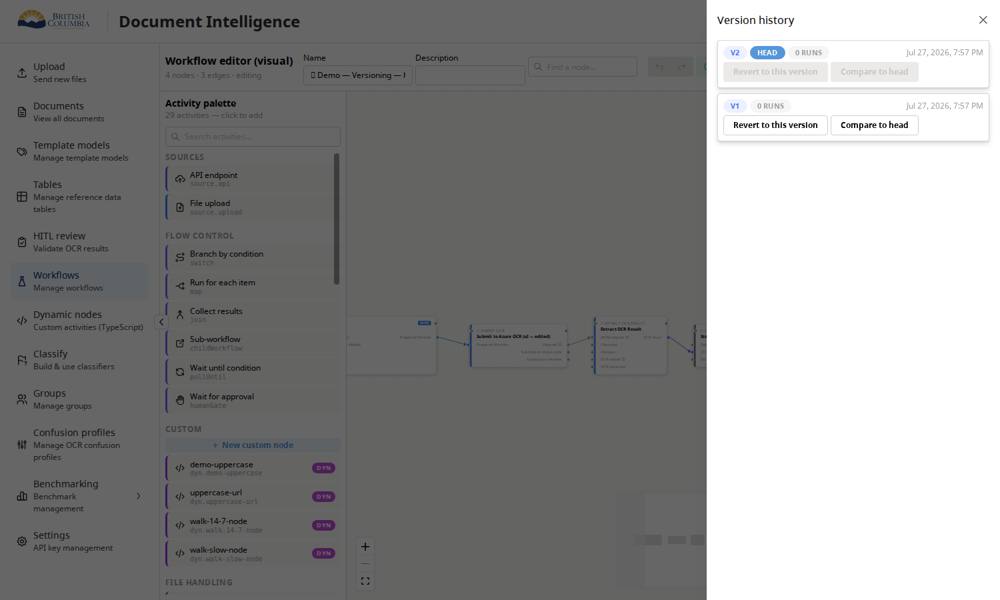

Every save makes a version. Nothing is overwritten.

**Do this.** Click **More ▸ History**.

**Look for**

- Newest first, with the current one marked **HEAD**, and how many runs used each.
- **Compare to head** opens on a **Changes** tab: each field that differs, with
  both values, and the unchanged ones folded away. The second tab, **Both
  versions in full**, shows the two side by side.
- **Revert to this version** brings an old one back — as a *new* version, so the
  history stays honest.

*Covers 12.1, 12.2, 12.3*

---

## 12 · Turn it into an API
**⏱ 3 min** · Open **🎯 Demo — Workflow-as-API**

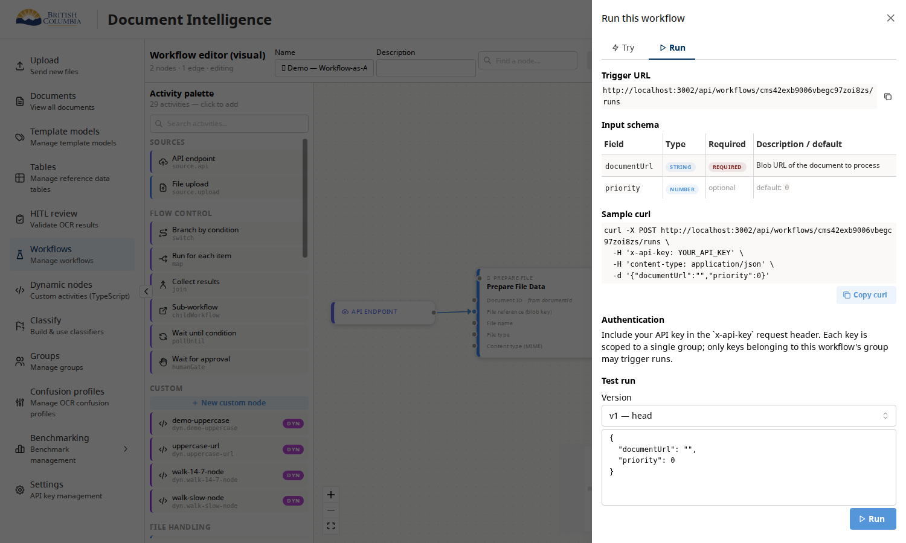

Any workflow can be triggered by another system.

**Do this.** Click **Run…** in the top bar, then the **Call from outside** tab.
The drawer opens on **Try on canvas** — that's the tab for running it yourself
(stop 8); **Call from outside** is the one that documents the API.

**Look for**

- The **Trigger URL** to call.
- The **Input schema** — every field the workflow expects, its type, whether it's
  required, and what it's for. This is derived from the diagram; nobody writes it
  by hand.
- A ready-made **Sample curl**, an **Authentication** note, and a **Start a run**
  box — a version picker, the same JSON body as stop 8, and a **Run** button that
  fires one off from here. A run started on this tab is recorded as an API call,
  so a later try never cancels it; a try started on the other tab can be. An API
  call is a production run, not a try: it doesn't appear in stop 10's Run
  history, and its step results are not kept for canvas previews. It creates no
  document either, so the **Documents** page doesn't list it. The drawer shows
  the run's id when it starts; look that id up in the Temporal UI at
  `http://localhost:8088` to follow it.

*Covers 11.1, 11.2, 11.3, 11.4*

---

## 13 · Let people upload files
**⏱ 3 min** · Open **🎯 Demo — Document sources**

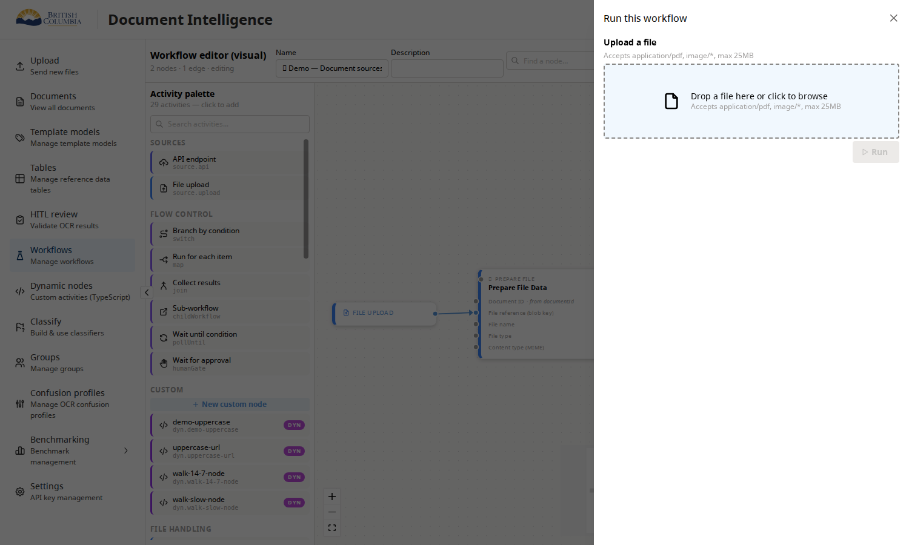

A workflow can start from a file instead of an API call.

**Do this.** Click **Run…** in the top bar.

**Look for**

- No tabs. A file is this workflow's only way in, so the drawer skips the
  **Try on canvas** / **Call from outside** pair you saw at stop 12 and opens
  straight on **Upload a file**.
- A drop zone stating what it accepts and the size limit — both come from the
  upload step's settings, so changing them changes this.
- Choosing a file and pressing **Run** uploads it *and* starts a run in one go,
  then closes the drawer so the canvas can show you the run.

*Covers 13.1, 13.3, 13.4*

---

# Part six — go further

## 14 · Write your own step ☁️
**⏱ 5 min** · Left nav ▸ **Dynamic nodes** ▸ **demo-uppercase**

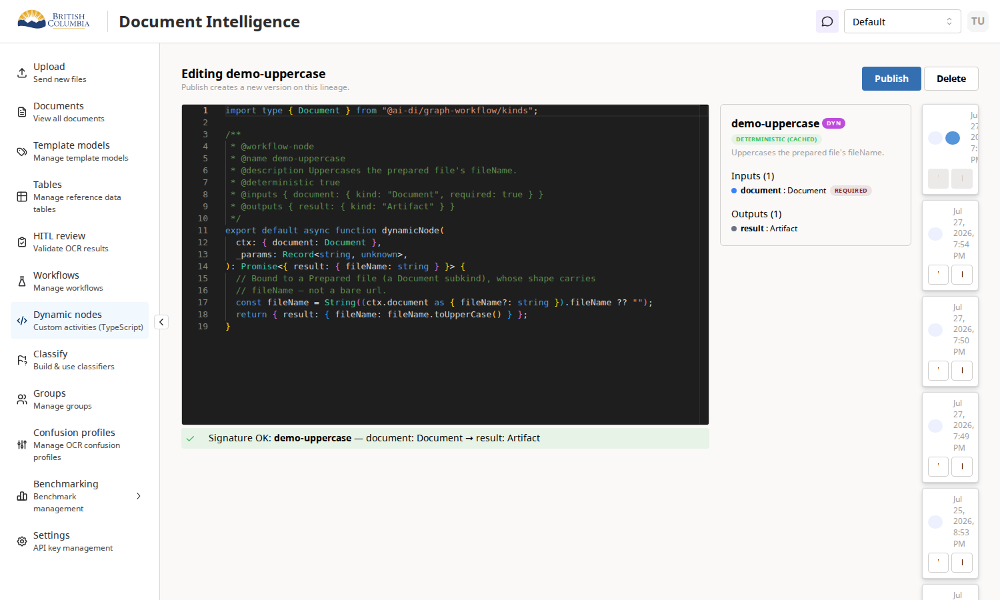

When no built-in step does what you need, you write one in TypeScript.

**Look for**

- The code editor on the left, with the comment block at the top declaring the
  step's name, its inputs and its outputs.
- The strip under the editor checks that comment block **as you type**. A green
  tick means the declaration is understood; red lines name each problem, with its
  line and column where it has one, and clicking a line jumps the editor there.
  **What is checked?** on the strip lists every check it makes, and the checks
  that wait for **Publish**.
- On the right, the step's preview: its name, description, inputs, outputs and
  parameters, read from the comment block and updated as you type.
- **Publish** makes a new version, and the step appears in every workflow's
  palette immediately — no restart.
- On the right, under the step's preview, every previous version, each
  restorable.

**Something's off if** the editor sits on *"Loading the script editor…"* for
more than a few seconds. It should either open or tell you it failed and disable
Publish; it should never leave you able to publish code you can't see.

*Covers 14.1–14.7*

---

## 15 · When a step goes missing
**⏱ 2 min** · Open **🎯 Demo — Deleted custom node**

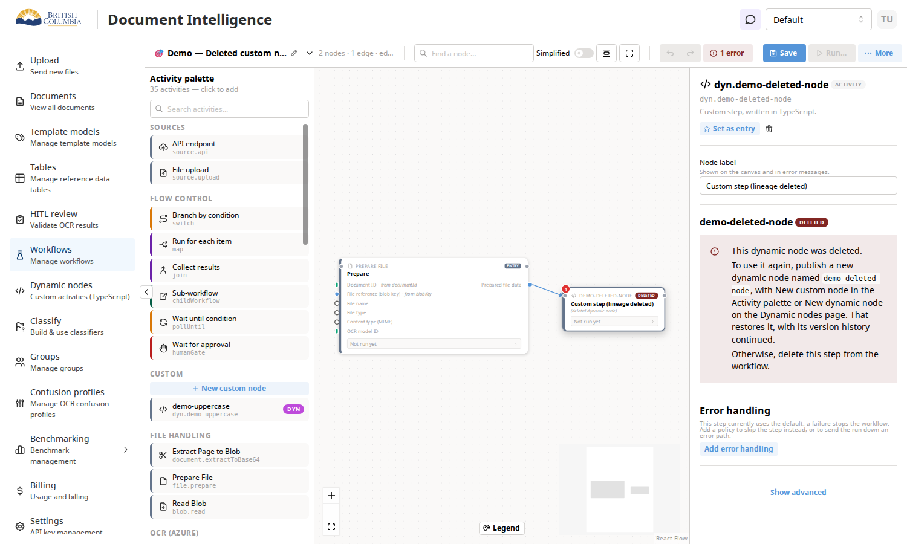

Custom steps can be deleted while workflows still refer to them. This is what
that looks like.

**The step is *meant* to be missing, and it is missing in one place only.**
`npm run seed:demos` publishes a custom step called `demo-deleted-node`, builds
this workflow on top of it, and *then* soft-deletes the lineage — that order is
the whole fixture, because a workflow has to reference a step before the step can
become a tombstone. So the two places you might go looking behave differently on
purpose:

- **Dynamic nodes** (left nav) does **not** list it, and that is correct.
  `GET /api/dynamic-nodes` excludes soft-deleted lineages by design. A
  tombstoned step is invisible on the management page — its absence there is the
  feature, not a seeding failure.
- **This workflow's canvas** is where it shows up: present, named, and broken.
  That's the only surface that still knows it existed, and it's what this stop is
  about.

**Look for**

- A red **DELETED** badge on the step and *"Custom step (lineage deleted)"* where
  its name should be.
- **1 error** in the top bar.
- Selecting it explains the situation and both ways out: *"This dynamic node was
  deleted. To use it again, publish a new dynamic node named
  `demo-deleted-node`, with New custom node in the Activity palette or New
  dynamic node on the Dynamic nodes page. That restores it, with its version
  history continued. Otherwise, delete this step from the workflow."*
- **Run…** in the top bar is disabled, and hovering it says why: *"Fix 1
  validation error first — this graph cannot run as it stands"*.

**Worth knowing.** The way back works although the step isn't listed on
**Dynamic nodes**: publishing under the name of a deleted step revives its
lineage and continues its version numbering rather than starting a fresh one.
Both buttons the alert names lead there — **+ New custom node** in the
workflow's Activity palette, and **New dynamic node** on the **Dynamic nodes**
page.

**Something's off if** the canvas has no such step *either*. Then the seeding
really did fail, and the cause is the deno-runner: this step has to be published
before it can be deleted, so a seed run without the runner skips the whole demo
and prints `– deleted-dyn    skipped (deno-runner unavailable)`. Start it and
re-seed — see [Before you start](#2--seed-the-demo-workflows).

This is the shape the whole product aims for: when something is broken, say so on
the diagram, in words, next to the thing that's broken — and don't offer a button
that can't work.

*Covers 14.8*

---

## 16 · Ask the assistant to build it
**⏱ 4 min** · Open **🎯 Demo — Agent: Invoice OCR Pipeline**

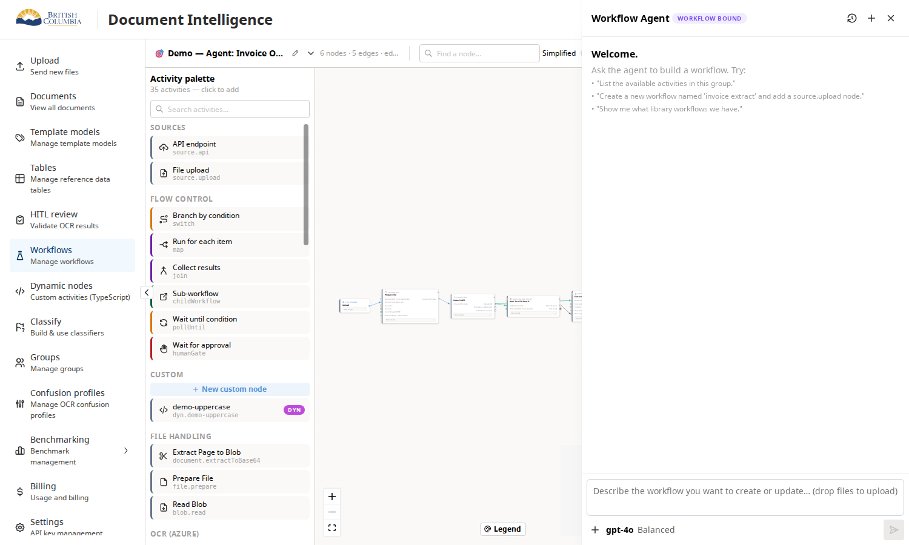

**Do this.** Open the chat drawer from the speech-bubble icon in the header.

**Look for**

- **Workflow bound** in the header — the assistant is working on *this* workflow,
  and edits land on the canvas beside you.
- Example prompts to start from.
- The model that will answer (a menu to choose another when the server offers
  more than one), and past conversations.

**Try this.** Ask it something plain, like *"add a step that stores the results."*
Watch the canvas as it works.

*Covers 15.1, 15.2, 15.3*

---

# You're done

If you noted anything that didn't match, that's the useful output. Two things
worth separating when you write it up:

- **"This did something different from what the page said."** That's a bug, and
  the page is the specification.
- **"This did what the page said, but I didn't understand why."** That's a design
  finding, and it's the more valuable of the two. The gallery describes what the
  product *does*; it can't tell you whether that was the right thing to do.

Known gaps, so you don't re-report them:

- **⛶ can't fit a long workflow into a narrow window.** The canvas zooms out only
  so far. In a window 1280 px wide, where the canvas is about 400 px once the
  app's menu, the palette and the settings panel take their share, the first and
  last steps of
  **Standard OCR Workflow** stay partly off-screen. At 1366 px and wider it fits.
  Widen the window, or pan.
